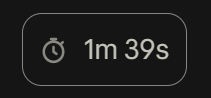
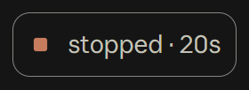

# turn-timer

A Claude Code mod that shows how long each turn took, in a small chip under Claude's reply.



The desktop app's Code tab tells you when a turn finished, but not how long Claude worked on it. turn-timer adds that, quietly, under the last block of each reply.

## What it shows

- **A finished turn:** a grey stopwatch and the time, such as `1m 39s`. Under a minute it's seconds (`42s`), over an hour it's hours and minutes (`1h 04m`).
- **A turn you interrupted:** a small orange square and `stopped · 1m 05s`. Orange is saved for this one case, because an interrupted turn is the one worth noticing.

  
- **Subagents' turns:** nothing. Only the main conversation's turns get a chip.
- **Surfaces that can't draw images, such as a terminal:** an italic line at the end of the reply instead, `took 3m 12s`.

The chip only changes what's drawn. The stored reply, and what Claude reads back, stay exactly as they were.

## Install

Mods install from a terminal. The desktop app's Code tab doesn't offer the `/plugin` command, so run these once in PowerShell, Terminal, or any shell where `claude` works:

```bash
claude plugin marketplace add Barncore/turn-timer
```

```bash
claude plugin install turn-timer@turn-timer --scope user
```

Then restart the desktop app, or start a new `claude` session.

To update later:

```bash
claude plugin marketplace update turn-timer
```

```bash
claude plugin update turn-timer@turn-timer --scope user
```

Then restart again. A running session keeps the copy it started with.

### What it needs

- **Claude Code 2.1.287 or later,** the release mods arrived in. They're on by default, but local settings, safe mode or an organisation policy can turn them off. See [Anthropic's mod docs](https://code.claude.com/docs/en/plugins/mods/overview#turn-mods-on-or-off).

## Good to know

- **The chip appears on replies that finish after turn-timer loads.** After you install it or restart the app, your earlier replies won't have one, because there's no record of how long they took. The next reply will.
- **A restart starts fresh.** The times live in the session's own state, which doesn't survive the app restarting.
- **It keeps the last 100 turns.** Scroll far enough back in a very long session and the oldest replies lose their chips.
- **Replies that end with the same words can share a chip.** If an older reply ends exactly like a newer timed one, say both are just `Done.`, the older one can show the newer one's time. That's the cost of the text fallback described under [How it works](#how-it-works).

## Tested on

- **Windows 11, the Claude desktop app's Code tab, Claude Code 2.1.295.** The chip has been seen drawing there, under real replies.
- **macOS: untested.** It should work. Mods are JavaScript run by Claude Code itself, and turn-timer touches no files, processes or OS features. But the desktop app draws mods itself, and a few drawing bugs have only been reported on Mac. If you try it on a Mac, an issue saying how it went would help.
- **Terminal:** the italic line is covered by the tests, but nobody has watched it in a real terminal yet.

## How it works

1. When Claude's reply arrives, turn-timer notes the id and text of the reply's last block.
2. When the turn ends, Claude Code reports how long it took. turn-timer stores that time against the block, once per turn.
3. When the Code tab draws that block, turn-timer draws the chip under the app's own drawing of the reply, so the reply keeps its formatting, text selection and copy button.

It matches the block by its id, and falls back to matching by its text, because Claude Code's docs don't promise that the id a reply is drawn under is the one it arrived with.

The stopwatch is one mid-grey (`#8a8883`) that reads on both the light and the dark theme, so turn-timer doesn't need to know which theme you use.

## What it can reach

From `claude plugin validate` on Claude Code 2.1.295:

```
hooks: session.append, turn.complete, ui.render{component=AssistantMessage}
calls: $.state.get, $.state.set, $.ui.resolve
```

In plain words: it sees replies arrive and turns end, and it draws under replies. It saves one small value per turn in the session's state, and has no file, network or process access.

## Develop

```bash
claude plugin validate .
```

```bash
claude plugin test .
```

## Licence

MIT, see [LICENSE](LICENSE).
